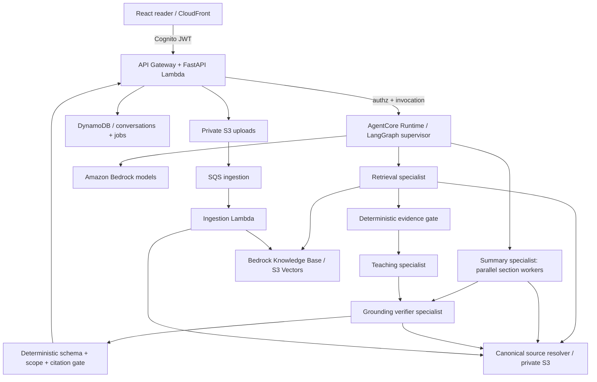
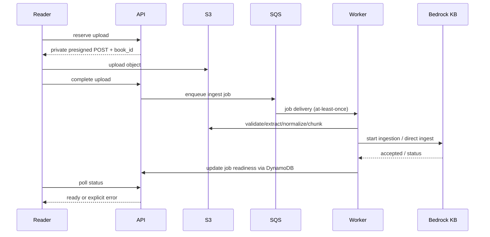

# 03 — System Architecture

## 1. Architecture choice

**Reference implementation v1.1:** React SPA on S3 + CloudFront, Cognito auth, API Gateway -> thin Python FastAPI Lambda (authz/quotas/API contracts) -> **one Amazon Bedrock AgentCore Runtime hosting a bounded LangGraph multi-agent graph**. Private S3 stores originals/canonical text/index staging; SQS -> Lambda ingests; DynamoDB stores ownership/conversations/jobs; Bedrock Knowledge Bases + S3 Vectors perform scoped semantic retrieval; Bedrock models power specialist agents. Neither Lambda nor AgentCore exposes unverified model drafts.

**Deployment boundary:** Lambda is the public API gateway and policy enforcement; AgentCore Runtime hosts the orchestration only. This separation is intentional, not duplicate execution. Individual specialist agents run as LangGraph subgraphs within **one Runtime**, sharing only typed state and book-scoped data access.



**Architecture invariant:** The frontend never talks directly to Bedrock KB, vector indexes or raw S3 credentials. The API enforces authorization and evidence policy.

## 2. Responsibilities

| Component | Responsibility | Not responsible for |
|---|---|---|
| SPA/reader | Render book, selection, citations, statuses | Authoritative ownership, AI evidence validation |
| API Lambda | AuthZ, quotas, session pinning, AgentCore invocation, HTTP contract | Trusting client book IDs blindly or running orchestration |
| Ingestion worker | Parse, chapter/page location, chunks, KB sync, cleanup | Answering user questions |
| AgentCore Runtime | Hosts one bounded LangGraph with selective specialist subgraphs | Public authentication, granting book permissions, bypassing final answer gate |
| Bedrock KB + S3 Vectors | Semantic retrieval of indexed book chunks | Authoritative access control or grounding proof |
| Bedrock model | Paraphrase/answer/claim analysis over evidence | Finding outside facts, controlling access, confirming citations alone |
| S3 normalized store | Immutable canonical text/locators by version | Public file hosting |
| DynamoDB | Book state, ownership, conversations, job state | Large page text/entire books |

## 3. Identity and authorization

A Cognito user has immutable `owner_id = Cognito sub`. API resolves ownership from JWT, never client input. Each book is keyed by unguessable UUID; `book_version_id` is immutable and bound on conversation creation. Validate `book_id -> owner_id`, then `book_version_id -> book_id`. Every retrieval must include equality filters on `owner_id`, `book_id`, `book_version_id`. Drop/abort on any wrong/missing hit metadata, even if the upstream KB returns it. Source-map lookup also validates the same triple.

## 4. Data layout

**DynamoDB `Books`**: `book_id` (PK), `owner_id`, `title`, `format`, `mime_type`, `raw_s3_key`, `active_version_id`, `status` (`pending_upload|uploaded|parsing|indexing|ready|failed|deleting|deleted`), `bytes`, `page_count`, `chapter_count`, `created_at`, `updated_at`, `failure_code`, `deleted_at`; `owner_id + created_at` GSI for private library listing.

**DynamoDB `Conversations`**: `conversation_id` (PK), `owner_id`, `book_id`, `book_version_id`, `created_at`, `last_message_at`; GSI by `owner_id` and `book_id` if required.

**DynamoDB `Messages`**: partition `conversation_id`, sort `created_at#message_id`, `role`, `status`, `text`, `citations`, `grounding_summary`, `mode`.

**DynamoDB `Jobs`**: `job_id` (PK), `owner_id`, `book_id`, `book_version_id`, `job_type` (`ingest|chapter_summary|delete`), `status`, progress phase, timestamps, retry count, result key/error code.

**Private S3 layout:**

```
raw/<owner_id>/<book_id>/<version_id>/original.pdf|original.epub
normalized/<owner_id>/<book_id>/<version_id>/manifest.json
normalized/<owner_id>/<book_id>/<version_id>/chapters/<chapter_id>.json
normalized/<owner_id>/<book_id>/<version_id>/chunks/<chunk_id>.json
kb-stage/<owner_id>/<book_id>/<version_id>/<chunk_id>.md
kb-stage/<owner_id>/<book_id>/<version_id>/<chunk_id>.md.metadata.json
summaries/<owner_id>/<book_id>/<version_id>/<chapter_id>.json
```

Do not place email address or book title in S3 keys or vector metadata. All normalized artifacts are immutable for a version. Option to store a `content_hash` for dedupe **within owner only**, without cross-user accidental data sharing.

## 5. Ingestion sequence



## 6. Selective multi-agent request paths

```mermaid
sequenceDiagram
  participant U as Reader
  participant API as Auth API / Lambda
  participant G as LangGraph / AgentCore
  participant KB as Scoped KB + canonical resolver
  participant M as Bedrock specialists
  U->>API: ask(conversation_id, question)
  API->>API: authenticate; authorize pinned book version
  API->>G: trusted scoped request (no client-supplied scope trust)
  G->>M: Supervisor route with minimal context
  M-->>G: validated task decision
  G->>KB: Retrieval specialist with strict book filters
  KB-->>G: canonical source IDs + hashes
  G->>G: deterministic scope and sufficiency gates
  alt insufficient
    G-->>API: safe refusal
  else adequate evidence
    G->>M: Teaching agent sees question + only validated passages
    M-->>G: claim-linked draft
    G->>M: Grounding verifier sees claims + canonical sources only
    M-->>G: claim-level verdict
    G->>G: deterministic scope + citation + policy gate
    G-->>API: verified answer or safe refusal
  end
  API-->>U: verified content only
```

**Summarization:** Supervisor -> exact chapter enumeration -> bounded parallel section workers -> reducer -> coverage ledger -> independent verifier -> deterministic publish gate. See `11-MULTI-AGENT-WORKFLOW.md`.

## 7. Error and retry principles

- Ingestion jobs use idempotency key `book_version_id`, bounded retries, dead-letter queue, exact error statuses.
- Model/API throttling returns 429/503 with safe retry. Never bypass verification under load.
- KB sync is eventually asynchronous. `ready` requires success + indexed canary validation; no premature ready state.
- On partial failure, do not expose unverified answer and do not mix a previous book's evidence.
- Propagate `correlation_id` across all services; log chunk IDs and timings, not book text.

## 8. Why AgentCore now?

Because v1.1 explicitly requires long-running, specialized multi-agent orchestration, AgentCore Runtime is now the **selected deployment target**. It hosts the graph, not a second API. The API continues to handle JWT/authz, input validation, quotas, and returning only publish-approved results. A local LangGraph runner implements the exact same graph during development and tests; AWS billing and service setup are deferred until the local source maps and contract tests pass. Do not create separate AgentCore runtimes for each logical agent in v1.1.

AWS: https://docs.aws.amazon.com/bedrock-agentcore/latest/devguide/

## v1.3 architecture event addition

`READY` transition -> idempotent `BRIEF_REQUESTED` async job -> canonical chapter traversal / bounded agent synthesis -> verifier -> deterministic publish gate -> private S3 brief artifact and DynamoDB status. `BOOK_OPENED` inside React -> authorized GET book + GET `/v1/books/{book_id}/brief` -> show verified cached brief or explicit state; **no Bedrock call on open**. Observe per-stage evaluation metrics and traces in controlled offline runs and optional AgentCore Evaluations online/on-demand. v1.1 ingestor Lambda-vs-Fargate deployment difference remains unresolved as described in `PRE-CODING-GATE-v1.2.md`.


## v1.4 architecture amendment

`SUMMARIZE_BOOK` runs as an authenticated queued job. A manifest enumerator reads canonical S3 chapter+section inventory; LangGraph Summarization Agent does bounded map/reduce and Grounding Verifier checks each layer; a deterministic publisher checks identity, citations, ledger and cached version. Bedrock KB search is **not** the chapter enumerator. Results are cached in private S3 with metadata in DynamoDB. `BOOK_OPENED` loads brief only; full-book summary is requested separately. AWS budget target `$50/month`: no always-on VPC/NAT/Fargate or managed index provisioned by default; the enterprise diagram is a staged target.
