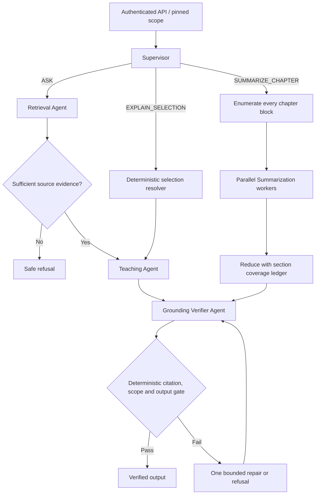

# 05 — Multi-Agent Grounding and Abstention Specification (v1.1)

## 1. Product property and limits

BookScope may display a factual statement only when the statement is supported by verified source passages in the **selected authorized immutable book version**. Multi-agent specialization reduces irrelevant context, but it does not mathematically eliminate hallucination or verifier errors. Final book scope and citation validation are performed by deterministic backend code independently of any agent.

## 2. Five logical roles (selectively invoked)

| Role | Task | Model-visible context | Forbidden inputs/actions |
|---|---|---|---|
| Supervisor | Select `ASK`, `EXPLAIN_SELECTION`, or `SUMMARIZE_CHAPTER`; bound plan | Current request, short sanitized referents, compact TOC/selected locator | Full book, raw old chats, open-ended tool list, web |
| Retrieval Agent | Rewrite/decompose query, find cross-section evidence | Query, chapter hints, scoped search results, limited canonical hits | Other books, credentials, arbitrary file/URL paths |
| Teaching Agent | Answer or explain in accessible language | Question, intent, validated EvidenceBundle passages with citations | Vector store access, web, unsupported examples, other chats |
| Summarization Agent | Summarize all chapter sections via map/reduce | One section block at a time; reducer receives verified section summaries | Skipping sections silently, using top-k as chapter inventory |
| Grounding Verifier Agent | Independently judge claims and coverage | Draft factual claims, canonical evidence, source locators, no generation rationale | Rewriting answer, fetching outside evidence, publishing text |

These are separate LangGraph nodes/subgraphs with private typed contexts running in **one AgentCore Runtime**; they are not five always-on AWS services.

## 3. Selective routes

The graph's nodes must not execute all roles in every flow. Summary tasks are asynchronous and may take many map calls, but all of their inputs are scoped to one chapter. Answering and selected-text explanation are interactive paths.

## 4. Context engineering and tool access

- **Supervisor:** at most a compact TOC, last two resolved referents (never previous assistant answers as factual evidence), request mode, and verified selection metadata. Output a schema-validated routing decision. No access to model-generated free-form hidden chain of thought.
- **Retriever:** at most three query variants and two retrieval passes, with scoped metadata filters on `owner_id`, `book_id`, `book_version_id`. Retrieve up to 10 candidates per pass; validate all results; construct max 12 canonical source references and optionally same-section neighbors when approved. Cap evidence text sent to Teaching Agent at configurable ~8,000 tokens; record truncation and abstain on missing crucial evidence.
- **Teacher:** sees task, the user question, any resolved selected phrase, and only the approved source evidence. Must output structured claim IDs and citation IDs. Disallowed to invoke retriever itself; request expansion through supervisor if evidence missing.
- **Summary mapper:** processes one section block (target 1,500–2,500 input tokens) and emits typed key concepts with source IDs. Run default max 3 mapping tasks concurrently, with strict ordered reduction and source coverage. A single map failure prevents a claim of complete summary.
- **Verifier:** loads only the final claims and original canonical referenced passages, does not receive generator notes/chain of thought; checks semantic entailment. Deterministic checks validate source ownership, book identity, version, hashes, locators, complete source coverage for summary, schema, and permitted statuses.
- **All roles:** no external internet research, cross-book search, arbitrary S3, user-controlled function names, code execution, or document modifications. Model-generated source IDs are untrusted until resolved server-side.

## 5. Exact handoff contracts

Machine-readable schemas: `schemas/agent-contract.schema.json`. Components:

- `SupervisorDecision`: `request_id`, `mode`, `subqueries` (0–3), `chapter_id?`, `reason_code`. No mutable ownership fields.
- `EvidenceBundle`: `request_id`, `book_version_id`, `question`, `passages[] {chunk_id, sha256, locator, section_id}`, `coverage`, `canonical_source_proof`. The `book_version_id` comes from the **trusted backend**, not from an agent.
- `TeachingDraft`: `request_id`, `claims[] {claim_id, text, evidence_chunk_ids[]}`, `status` as candidate; draft is NEVER streamed.
- `VerificationVerdict`: `request_id`, `claim_results[] {claim_id, supported, evidence_chunk_ids[]}`, `coverage_ok`, `decision`, `reason_code`. A model `pass` does not override backend checks.

Use IDs/hashes in handoffs and fetch canonical source text by authorized resolver. Keep retrieval and proof artifacts in trusted graph state, not in untrusted prompt messages.

## 6. Sufficiency, verification, and abstention

Sufficiency requires each requested factual component to have adequate evidence; top similarity alone is not sufficient. For multi-part requests, a partially supported response may only be returned with explicitly delimited unsupported portions and the `partial` status; otherwise refuse. Always distinguish missing evidence from an invalid source or processing failure.

Verification sequence: (1) validate structured output; (2) reauthorize every source against current book/version and deletion state; (3) validate hashes and locator mapping; (4) compare each claim to its cited canonical spans using a separate verifier prompt/model invocation; (5) check completeness ledger for chapter summaries; (6) publish only approved final text. If semantic verification is inconclusive, fail closed. One bounded rewrite against the **same validated evidence** is permitted, followed by full re-verification. No unverified token streaming.

User-visible `AnswerResponse.status` values are `answered`, `partial`, `insufficient_evidence`, `verification_failed`, `unsupported_content`, `processing`. `partial` is permitted only for a mixed request with at least one verified supported claim and an explicit statement of what could not be established; chapter-summary jobs separately expose `Job.status=partial` when sections are missing. OpenAPI and JSON Schema both enforce non-empty citations for `answered` and `partial`.

## 7. Retry and execution budgets

- Supervisor route: once, with deterministic schema-error fallback to refusal.
- Retrieval: max two book-scoped passes; at most three subqueries in total.
- Teaching: one draft plus max one repair against validated evidence.
- Verifier: one call per draft plus re-verification if repaired.
- Summary mapping: all canonical sections, bounded parallelism 3, bounded per-section retries 1, ordered reducer, explicit partial/failed state.
- Enforce per-invocation token, time and USD budgets by environment. If exceeded, terminate with a non-answer status; never skip checks to meet latency target.

## 8. Threat model and telemetry

Test injection in book content, agent-generated fake source IDs, prompt attempts to change book scope, hallucinated citation page numbers, supervisor route manipulation, and verifier overtrust. Only the API can authorize books; the Runtime/tool resolver rechecks every call. Never log raw book text, user questions or drafts by default. Log stage name, model identifier, tokens, source IDs, timestamps, cost estimate, retry count, route, verifier outcome, and refusal reason.

## 9. Acceptance and honest claims

Compare single-agent baseline versus multi-agent variant using identical book-level holdout sets and retrieval corpus. Report claim support, correct refusal, false refusal, retrieval recall, completeness, mean/p95 end-to-end latency, total tokens and USD/call. Multi-agent stays if it improves critical safety/quality outcomes enough to justify the overhead; specialization alone does not establish improvement.

See `11-MULTI-AGENT-WORKFLOW.md` for worked flows, escalation, responsibilities and exact testing requirements.

## v1.3 brief workflow

`GENERATE_BOOK_BRIEF` is an internal async workflow over a fixed complete chapter inventory with bounded section-level workers, evidence-linked synthesis, separate verifier and the same deterministic publisher. The source scope is one user-owned immutable book version. Cache only verified claims. LLM verification is defense in depth; no model can approve ownership, hashes or source locations. Runtime book open reads the cached artifact, not a generation model.

## v1.4 additional intent: `SUMMARIZE_BOOK`

Supervisor routes to a dedicated asynchronous summary path with canonical chapter enumeration. Summarization specialist maps/validates source units, reduces chapters then entire book; Grounding Verifier validates every material synthesis claim; deterministic publisher checks coverage and source IDs. Neither the Teaching Agent nor Retrieval Agent is required on this summary path. See spec 14. The brief-on-open flow is unchanged.
