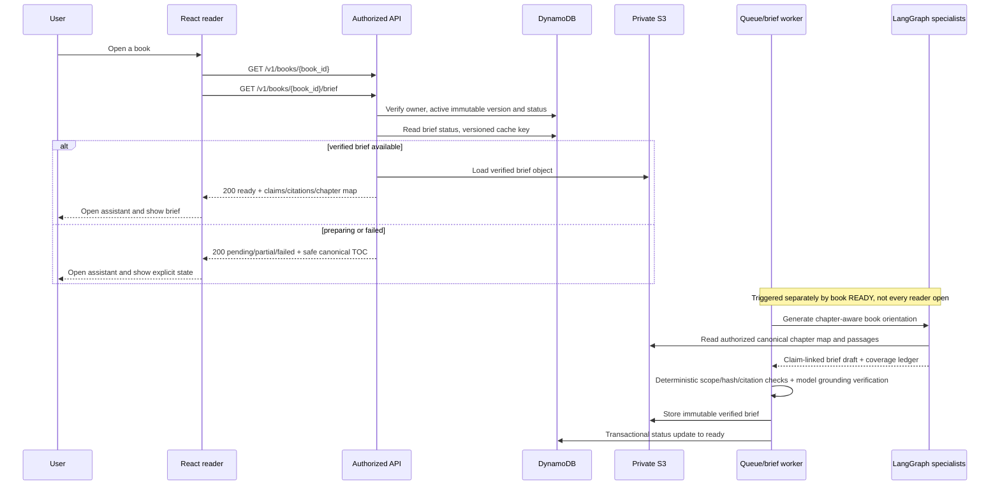

# 12 — Agent-First Book Opening and Book Intelligence Brief (v1.3)

**Status:** Approved product/engineering change request, not implemented. Applies to the BookScope reader experience, not arbitrary files opened in operating-system or third-party applications. A future optional browser extension can request permission to launch supported books in BookScope; it must not read arbitrary documents without user consent.

## 1. User goal

A reader should obtain a grounded orientation to a book immediately upon opening it, without having to first read hundreds of pages or manually copy a passage into a chatbot. The app opens a contextual AI assistant by default and displays a verified **Book Intelligence Brief**—not an empty chat pane.

### FR-022 — Agent panel auto-open
- On `BOOK_OPENED` inside BookScope, the reader opens the right-side assistant panel by default, unless this reader explicitly collapsed it during the current session or has persisted an accessibility preference. Do not steal text-input focus or show a blocking modal. User can close the assistant, continue reading, and reopen it.
- Book identity (`owner_id`, `book_id`, `book_version_id`) is determined server-side. Conversation is pinned to immutable version. Switching books resets active context; never carry previous book passages into the new thread.
- The `BOOK_OPENED` event is a UI signal for fetching the persisted brief and opening the panel. It MUST NOT invoke a fresh LLM call by default.

### FR-023 — Book Intelligence Brief
A book-level orientation includes:
1. Book identity (title, optional author only if present in source metadata).
2. An evidence-supported two-to-five-sentence description of scope and intended topics, without claims beyond the source.
3. Chapter map, chapter navigation and compact, source-backed descriptions for chapters whose content was verified. If metadata provides only the chapter title, label the entry `outline_only`.
4. Five to ten key concepts or learning outcomes supported by source span IDs; omit unsupported concepts.
5. Suggested starting points **derived from chapters**, labeled as navigational suggestions and not authoritative pedagogical outcomes.
6. Contextual quick actions: `Understand the book`, `Summarize this chapter`, `Explain the selected passage`, `Quiz me on this chapter` (quiz action disabled until a later version supports its contracts), and `Ask a question`.
7. Navigation into the canonical source for any factual claim.

**Scope distinction:** a short book orientation with a traceable chapter map is NOT a claim to have fully summarized every detail. As of v1.4, comprehensive **full-book summaries are included in the first release** as a separate user-initiated, asynchronous workflow. The cached brief must never be labeled a complete summary.

### FR-024 — Opening states
- Book `uploaded|parsing|indexing`: reader can show original where possible; assistant panel shows index progress, TOC if confirmed available, and disabled evidence-dependent actions. It never fabricates an overview.
- Book `ready`, brief `ready`: immediate cached display; zero model invocations on open.
- Book `ready`, brief `queued|generating|verifying`: display canonical TOC/limited outline with an explicit `Overview preparing` state. Question-answering remains available independently of brief generation.
- Brief `partial`: show only verified portions, unverified sections omitted or explicitly labeled incomplete. Do not present incomplete contents as whole-book insight.
- Brief `failed`: show canonical TOC and ask-book interface; clear error and explicit retry action. Do not silently substitute a generic LLM summary.
- Book `deleting|deleted` or unauthorized: no book text, book metadata or previous brief exposed; revoke content.
- On network error, retain UI navigation where locally authorized/cached, but do not claim fresh verification or reveal unowned books.

### FR-027 — From orientation to guided understanding (P1 after reliable brief)

The default panel offers an explicit **"Teach me this book"** entry point. On selection, the user chooses one of three grounded learning journeys: (a) 5-minute overview, (b) explore key concepts, or (c) chapter-by-chapter guided teaching. The Teaching Agent then uses only verified chapter/section evidence and asks targeted comprehension questions whose answer keys are also citation-supported. The experience may personalize the *order and explanation depth*, but cannot introduce external facts. It is not automatically started on open: generation and interactive teaching require explicit user action. Early V1.3 may show the entry point with a supported-only orientation; adaptive teaching and quiz scoring remain a gated P1 deliverable, not a launch promise.

**Learning outcome eval:** independently annotated concept comprehension questions, before/after task score and citation-valid answer keys, with transparent denominators. Completing the overview is not evidence that the user understood the book.

## 2. Events and sequence

- Ingestion `READY` transition emits idempotent `BRIEF_REQUESTED` job; unique key `owner_id/book_id/book_version_id/brief_spec_version/model_version/locale` and strict conditional insert. `BOOK_OPENED` only reads status and cached bytes; it never schedules duplicate work on every read.
- A user-initiated `Regenerate brief` action may enqueue one idempotent refresh with explicit cost/rate controls and must not overwrite an older verified object until new one passes checks.
- Changes to book version, model or prompt spec create a NEW cache artifact; never mutate the verified artifact for a pinned version.

## 3. Agent execution (async, selective)

- A deterministic planner enumerates all chapters/section IDs from the canonical manifest. It constructs a `CoverageLedger`; agents cannot invent chapters.
- Summarization workers receive small authorized chapter/section batches, extract *supported* topics/learning goals with evidence IDs, and mark missing or unreadable sections. Parallelism is bounded.
- The Teaching Agent synthesizes a readable orientation from verified worker outputs (not from unbounded raw full-book context). It can produce a navigable reading guide without claiming material not evidenced.
- The Grounding Verifier checks the final claims against canonical excerpts and tracks incompleteness. The backend publication gate checks ownership, immutable source hashes, supported citation IDs/locators, coverage, schema and current deletion status.
- Supervisor is only used when routing/complexity requires it. Do not invoke Retrieval Agent to find a handful of top-k passages and pretend the resulting summary covers the entire book.
- All agent tools are scoped to one authenticated book version; no web calls and no outside-book summaries.

## 4. Persistent data and public API

### DynamoDB `BookBriefs`
Partition: `book_version_id`; sort: `brief_spec_version#model_version#locale`; fields include `owner_id`, `book_id`, `status`, `job_id`, `s3_key`, `source_manifest_sha256`, `coverage_ratio`, `created_at`, `verified_at`, `failure_code`. Ownership/version checks are repeated on reads. Keep raw canonical content in private S3, not DynamoDB.

### Private S3
`briefs/<owner_id>/<book_id>/<book_version_id>/<brief_spec_version>/<model_version>/<locale>/brief.json`; no public ACL. Use new immutable key per version and only publish an explicitly verified artifact.

### GET `/v1/books/{book_id}/brief`
- Authenticated; ownership checks; `200` with `status=ready|queued|generating|verifying|partial|failed|unavailable` and version-pinned `BookBriefResponse`.
- Only `ready`/`partial` responses can include verified brief claims; `queued|generating|verifying|failed` can show canonical TOC-derived navigation objects with `outline_only` labels, but no invented statements.
- 401/404/409/429/503 use existing API error contracts; unauthorized is always 404. Cache-control: private and version-aware. ETag conditional GET supported; never place user document content in shared CDN caches.
- Response includes `book_version_id`, `brief_spec_version`, `book_status`, `status`, `chapters`, `overview`, `key_concepts`, `citations`, `coverage`, `updated_at`.
- `POST /v1/books/{book_id}/brief/refresh` is an optional future explicit action, not needed in first build.

## 5. Accessibility, UX, privacy

- Sidebar opens automatically *within BookScope* and must be dismissible, keyboard accessible and screen-reader labeled; opening a document must not hijack page focus or force unrequested long model conversations.
- Book opens and reader navigation must work during index/brief processing. No overbroad permissions for future browser-extension integration.
- No book text in analytics, traces or error telemetry by default. Never log raw user questions with private excerpts absent explicit opt-in and retention policy.
- Do not open external PDF files automatically or intercept other applications in V1.3; future extension/OS integration requires separate product/permission/security specifications.

## 6. Functional acceptance tests

| ID | Scenario | Expected |
|---|---|---|
| UX-OPEN-01 | Open a ready book with a verified brief | Assistant panel visible and brief displayed; **zero new LLM calls** |
| UX-OPEN-02 | Reopen same book in two tabs | Same immutable brief; no duplicate background generation |
| UX-OPEN-03 | Open newly indexed book while brief still generating | Clear pending brief state; ask-book works; no fictitious summary |
| UX-OPEN-04 | Open another book | All active scope, conversations, citations and sidebar content switch correctly |
| UX-OPEN-05 | Delete or revoke access during brief display | No further source fetch/brief disclosure; cache invalidation follows revocation |
| UX-OPEN-06 | Brief worker fails or verification rejects draft | Safe TOC fallback; never display unverified claims |
| UX-OPEN-07 | PDF/EPUB citation click from brief | Correct physical page / spine-anchor opens and shows canonical passage |
| UX-OPEN-08 | Collapse or keyboard navigate panel | User preference respected; focus stays predictable |
| BRIEF-01 | All content sections available | Complete source chapter inventory, verified claims and coverage ledger |
| BRIEF-02 | Some chapters unextractable | `partial`, unsupported sections disclosed; no blanket complete-summary claim |
| BRIEF-03 | Version/prompt changed | New cache entry and verification; old artifact not misattributed |
| BRIEF-04 | TOC-only preview | Factual claims restricted to actual titles/headings; explicit `outline_only` |
| BRIEF-05 | Malicious instructions in chapter text | Ignore instructions, verified-only claims, no scope changes |

**Engineering decision:** Improve time-to-first-valuable-learning, not merely time-to-open-a-chat-window. Measure actual comprehension in a human study before claiming that BookScope replaces reading.

## v1.4 clarification

`BOOK_OPENED` continues to fetch **only** cached verified Book Intelligence Brief; no fresh model inference. The user may explicitly choose `Summarize entire book`, which POSTs `/v1/books/{book_id}/full-summary`. That async job remains independent of brief cache and returns verified/partial/failed with the exact chapter coverage ledger.
